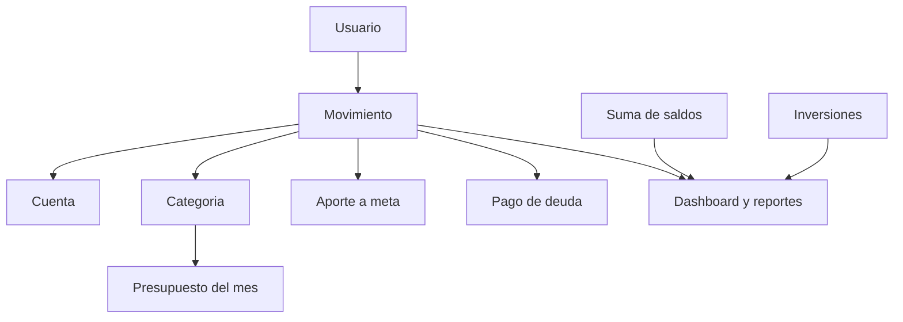
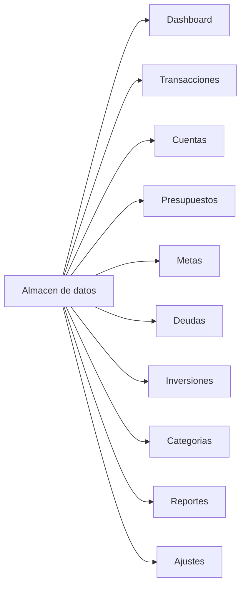

# Cómo va a funcionar Control (gastos e ingresos)

Este documento describe el **modelo de la app**: qué hace cada parte y **cómo se conecta la información**. Hoy la interfaz ya muestra esas piezas con datos de ejemplo (`src/data/mock.ts`). Cuando se implemente la lógica, no se inventan números sueltos por pantalla: **todo se deriva de los mismos registros**.

## Estado actual vs. objetivo

| Ahora | Después |
| --- | --- |
| Pantallas estáticas con mock | Un solo almacén de datos (al inicio, en el navegador) |
| El modal no guarda | Un movimiento nuevo actualiza cuentas, presupuestos, dashboard y reportes |
| Filtros solo decoran o recortan el mock | Los filtros leen la misma lista real |

Uso previsto: **localhost**, una sola persona (finanzas personales).

## Idea central

El corazón de la app es el **movimiento** (ingreso o gasto). Casi todo lo demás se calcula a partir de él.

- **No se edita el “balance del mes” a mano.** Ingresos, gastos y ahorro del periodo se suman desde movimientos con fecha dentro del periodo elegido.
- **No se edita el saldo de una cuenta a mano** (salvo un ajuste explícito). El saldo es saldo inicial + movimientos de esa cuenta.
- Presupuestos, metas y deudas **leen** movimientos etiquetados, no copian montos sueltos.

## Entidades y cómo se relacionan

### Usuario y ajustes

Hay un perfil (nombre, correo) y preferencias: moneda, día en que empieza el mes, avisos.

El **periodo** (este mes, mes anterior, este año) no es un dato guardado por transacción: es un **filtro de fechas** que aplica dashboard, listas y reportes.

### Categoría

Cada categoría es `ingreso` o `gasto` (Salario, Alimentación, Vivienda, etc.).

Se usa para:

- Clasificar cada movimiento
- Armar el presupuesto mensual (un tope por categoría de gasto)
- Graficar “en qué se fue el dinero”
- Totales en Reportes

Si se renombra o se archiva una categoría, los movimientos viejos **siguen apuntando a su id**, no al texto.

### Cuenta

Efectivo, bancos, tarjetas. Cada una tiene un **saldo de partida** (el día que empiezas a usar la app).

A partir de ahí:

`saldo actual = saldo inicial + ingresos de esa cuenta − gastos de esa cuenta`

Un movimiento **siempre pertenece a una cuenta**. Por eso Cuentas y Transacciones muestran la misma historia: solo cambia el agrupado.

Transferencia entre cuentas (cuando se implemente): dos movimientos internos o un tipo `transferencia` que no cuenta como ingreso/gasto del mes, pero sí mueve saldos.

### Movimiento (transacción)

Campos que importan para conectar todo:

| Campo | Para qué sirve |
| --- | --- |
| Tipo | ingreso / gasto (o más adelante transferencia) |
| Monto y fecha | Totales del periodo y orden de la lista |
| Categoría (id) | Presupuesto, donut, reportes |
| Cuenta (id) | Saldo de esa cuenta |
| Descripción | Búsqueda y lectura humana |
| Opcional: meta / deuda | Si el gasto es un aporte o una cuota |

Al guardar un movimiento:

1. Se agrega a Transacciones.
2. Cambia el saldo de la cuenta.
3. Si es gasto y hay presupuesto para esa categoría en el mes de la fecha, sube el “gastado”.
4. Si está ligado a una meta, sube el ahorro de esa meta.
5. Si está ligado a una deuda, baja el saldo de esa deuda.
6. Dashboard y Reportes se recalculan solos (son lecturas, no tablas aparte).

### Presupuesto

Un presupuesto es: **categoría + mes + tope**.

`gastado = suma de gastos de esa categoría con fecha en ese mes`

`porcentaje = gastado / tope`

Si gastado > tope, la UI marca “Excedido”. El aviso de Ajustes solo dispara si esa condición se cumple.

El presupuesto **no guarda** el gastado: lo calcula.

### Meta de ahorro

Una meta tiene objetivo, fecha y (opcional) cuenta de destino.

`ahorrado = suma de movimientos marcados como aporte a esa meta`  
(o transferencias hacia la cuenta de la meta)

Así Metas y Transacciones no se desincronizan.

### Deuda

Una deuda tiene saldo, cuota y próxima fecha.

Un pago es un **gasto** (o un tipo `pago_deuda`) ligado a esa deuda:

`saldo deuda = saldo inicial − suma de pagos`

“Al día / próxima / vencida” se calcula con la fecha de la próxima cuota frente a hoy, no se escribe a mano salvo un override raro.

### Inversión

Es un bloque más independiente: valor actual y variación. Puede vivir como:

- snapshots que el usuario actualiza, o
- movimientos de tipo inversión (compra/venta) más un valor de mercado.

Hasta que no haya API de mercado, el usuario carga el valor. El dashboard solo **suma** el portafolio; no inventa cotizaciones.

## Qué muestra cada pantalla (misma data)

- **Dashboard:** KPIs del periodo, gráficos, últimos movimientos, cuotas próximas, recortes de metas/deudas/inversiones. Todo son consultas al almacén.
- **Transacciones:** lista completa; filtros por tipo, categoría, cuenta, fechas.
- **Cuentas:** fichas con saldo derivado + últimos movimientos de esa cuenta.
- **Presupuestos:** topes del mes vs. suma de gastos por categoría.
- **Metas / Deudas / Inversiones:** cada una lee su entidad + los movimientos vinculados.
- **Categorías:** catálogo; el “total del mes” es una suma, no un campo editable.
- **Reportes:** las mismas sumas, con otro recorte de fechas (año, comparación de meses).
- **Ajustes:** perfil y flags; no duplican finanzas.

El botón **Nuevo** abre el mismo formulario en cualquier ruta. Un solo `createMovement` alimenta todas las vistas.

## Flujo de un gasto (ejemplo)

1. Usuario registra: $86, categoría Alimentación, cuenta Tarjeta débito, 27 sep.
2. Transacciones muestra la fila.
3. El saldo de Tarjeta débito baja $86.
4. Presupuesto de Alimentación de septiembre suma $86 al gastado.
5. Dashboard: sube “Gastos del mes”, baja “Ahorro del mes” (`ingresos − gastos`), se actualiza el donut.
6. Reportes del año incluyen ese gasto en septiembre.

Nada de eso es un update separado por pantalla: **un registro, muchas lecturas**.

## Periodo y moneda

- **Periodo** (header): recorta por fecha. “Este mes” usa el día de inicio de Ajustes (día 1 o 15).
- **Moneda:** solo formatea números. Los montos se guardan como número en una moneda base (la de Ajustes).

## Cómo se va a persistir (cuando toque lógica)

Orden razonable para localhost:

1. **Memoria + `localStorage`** (o IndexedDB si crece el historial): un objeto `{ accounts, categories, movements, budgets, goals, debts, investments, settings }`.
2. Al iniciar, se hidrata el estado; cada alta/edición/borrado reescribe el almacén.
3. Más adelante se puede cambiar el adaptador por una API sin rehacer las pantallas, si las páginas solo hablan con funciones tipo `listMovements`, `createMovement`, `getMonthSummary`.

Regla: **el dashboard no tiene su propia base de datos.** Tiene funciones que agregan movimientos.

## IDs, no textos

En el mock actual, categoría y cuenta van como string. En la versión real deben ser **ids**:

- `categoryId` → fila en Categorías
- `accountId` → fila en Cuentas
- `goalId` / `debtId` opcionales en el movimiento

Así un cambio de nombre no rompe históricos ni presupuestos.

## Qué no está conectado a propósito (aún)

- Login / varios usuarios
- Banco en tiempo real
- Exportar PDF/CSV (será otra lectura de los mismos movimientos)
- Cálculo de intereses de deudas o precios de acciones

Cuando se implemente cada módulo, este archivo es la referencia: **si una cifra no se puede explicar con un movimiento o un saldo inicial, no debería existir en la UI.**
